# TelecomWiki — Diagramas del sistema

Diagramas oficiales del proyecto (entidad-relación, casos de uso, procesos
y secuencia). Están escritos en **Mermaid**: se ven en GitHub, en la
extensión *Mermaid Preview* de VS Code o pegándolos en <https://mermaid.live>.

> Toda la información de apoyo está en [`MODELO-DE-DATOS.md`](MODELO-DE-DATOS.md)
> (tabla por tabla), [`ARQUITECTURA.md`](ARQUITECTURA.md) (capas y flujo de
> una petición) y [`../backend/database/database.sql`](../backend/database/database.sql)
> (esquema real, vistas e índices).

---

## 1. Diagrama entidad-relación

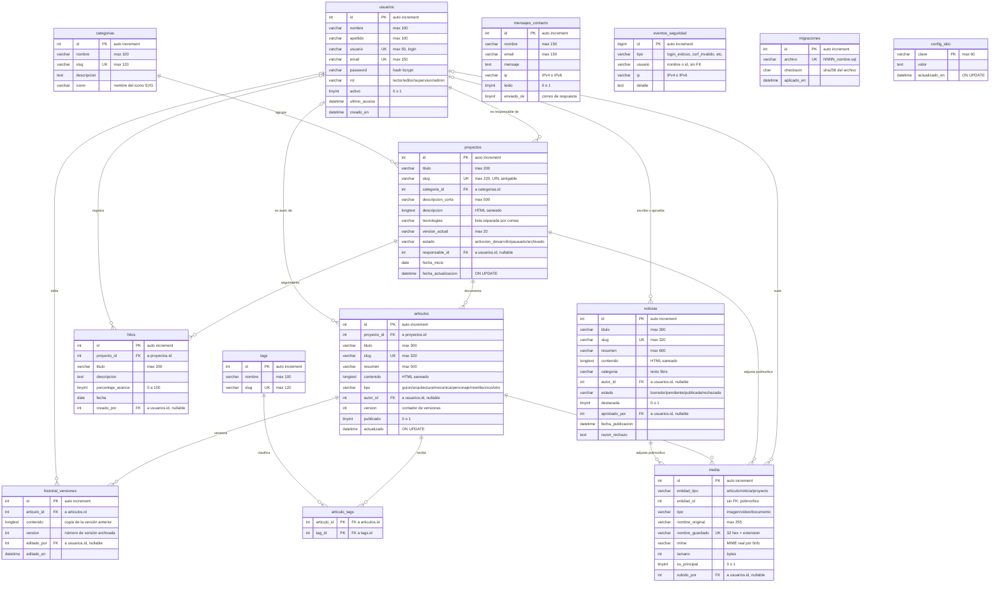

Notas sobre el modelo:

- **`media` es polimórfico** (`entidad_tipo` + `entidad_id` sin clave
  foránea): por eso al borrar una noticia/proyecto el código llama a
  `eliminarMediaDe()`. Es la única relación sin FK.
- **`eventos_seguridad`** tampoco tiene FK hacia `usuarios`: debe seguir
  registrando intentos de acceso con nombres inexistentes.
- **Estado de noticia** es la única fuente de verdad de «¿está visible?»:
  no existe una columna `publicada`.
- **Vistas** disponibles en el esquema:
  `v_proyectos_resumen`, `v_articulos_publicados`, `v_noticias_publicadas`,
  `v_noticias_moderacion`.

---

## 2. Diagrama de casos de uso

Sistema delimitado por el recuadro; cada actor entra por los casos que su
rol permite (ver tabla de capacidades más abajo).

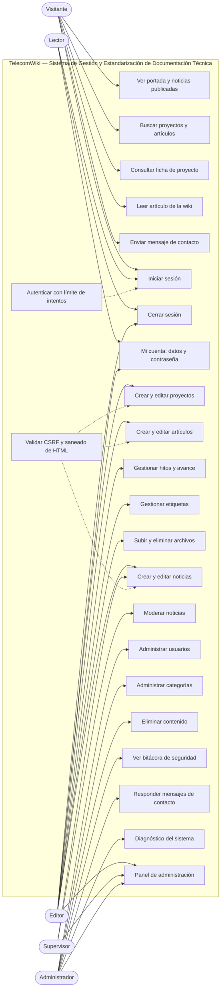

Relación con permisos (`backend/lib/permisos.php`):

| Caso de uso | Capacidad requerida | Rol mínimo |
|---|---|---|
| Ver/buscar/leer contenido público | — (público) | cualquiera |
| Iniciar sesión / cerrar sesión | — | — |
| Mi cuenta (datos y contraseña) | sesión iniciada | cualquier rol |
| Panel de administración | `panel.acceder` | editor |
| Crear/editar proyectos y artículos | `proyecto.*` / `articulo.*` | editor |
| Gestionar hitos, etiquetas y archivos | `hito.gestionar`, `etiqueta.gestionar`, `media.*` | editor |
| Crear noticias | `noticia.crear` | editor |
| Moderar noticias | `noticia.moderar` | supervisor |
| Eliminar noticias/proyectos | `noticia.eliminar`, `proyecto.eliminar` | admin |
| Usuarios, categorías, mensajes | `usuario.gestionar`, `categoria.gestionar`, `mensaje.gestionar` | admin |
| Bitácora de seguridad | `bitacora.ver` | admin |
| Diagnóstico del sistema | `panel.acceder` | editor |

---

## 3. Diagramas de procesos (actividad)

### 3.1 Alta y edición de artículos con control de versiones

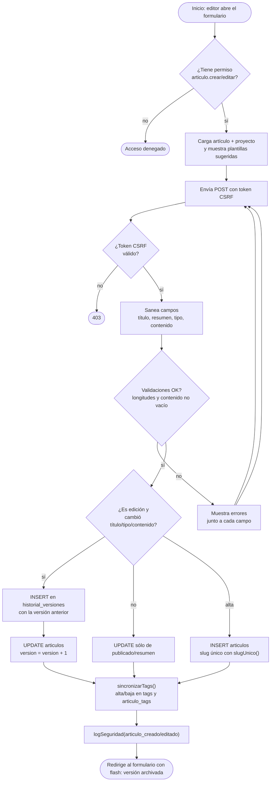

### 3.2 Moderación de noticias (separación de funciones)

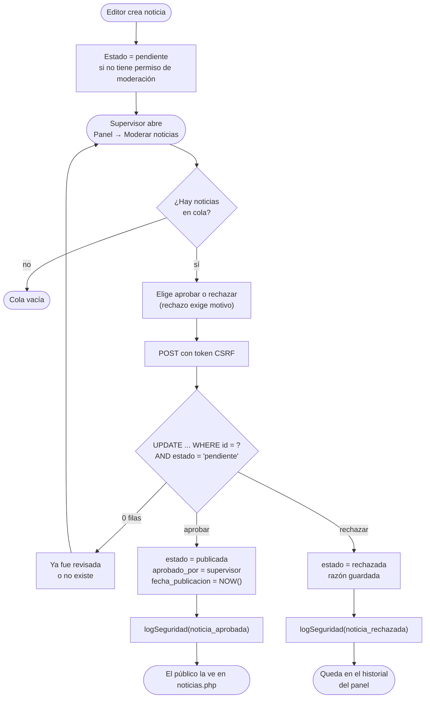

### 3.3 Subida y borrado de archivos

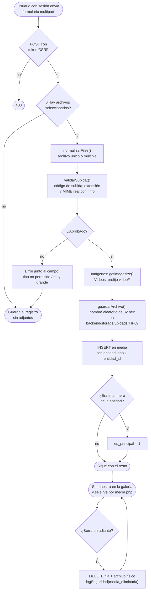

### 3.4 Autenticación con límite de intentos

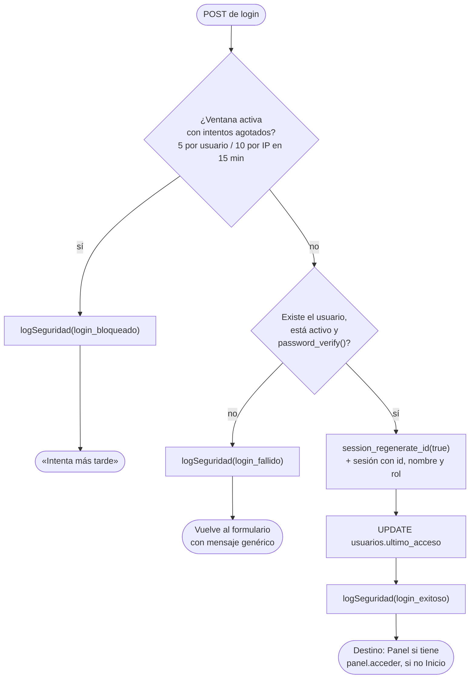

---

## 4. Diagramas de secuencia

### 4.1 Inicio de sesión

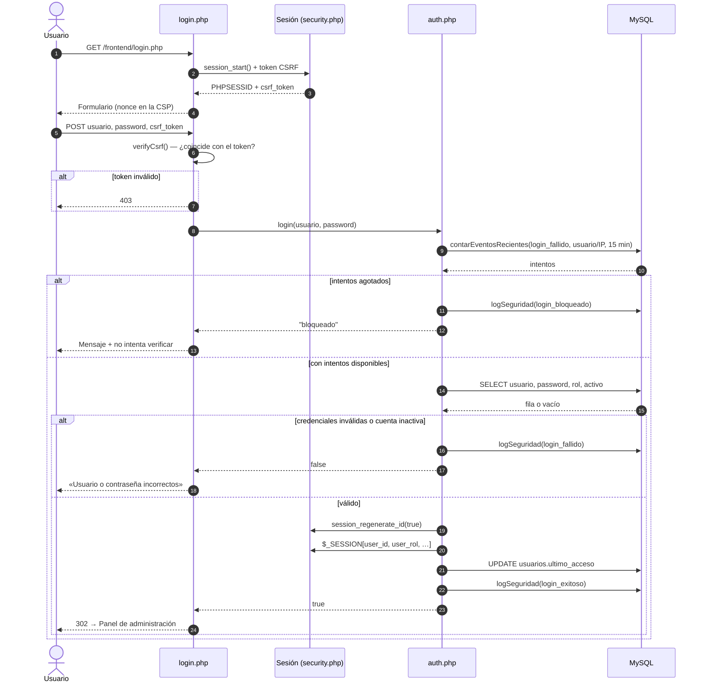

### 4.2 Guardado de un artículo (con versionado)

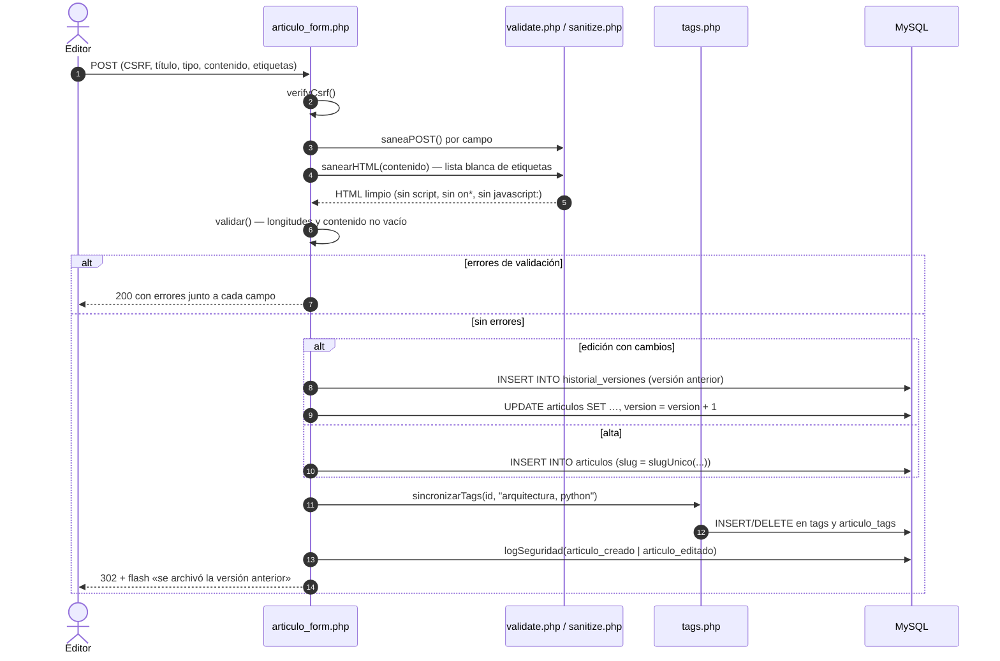

### 4.3 Subida de un archivo multimedia

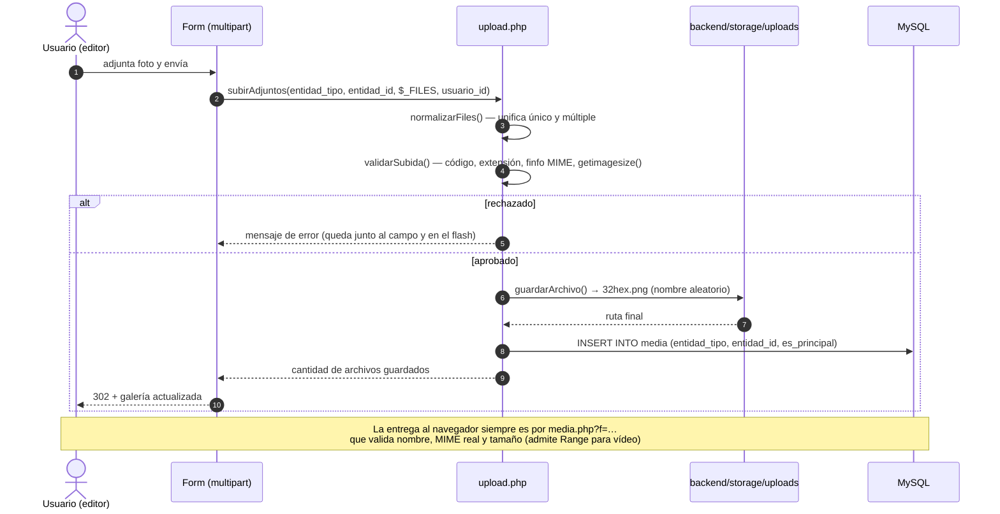

### 4.4 Aprobación de una noticia

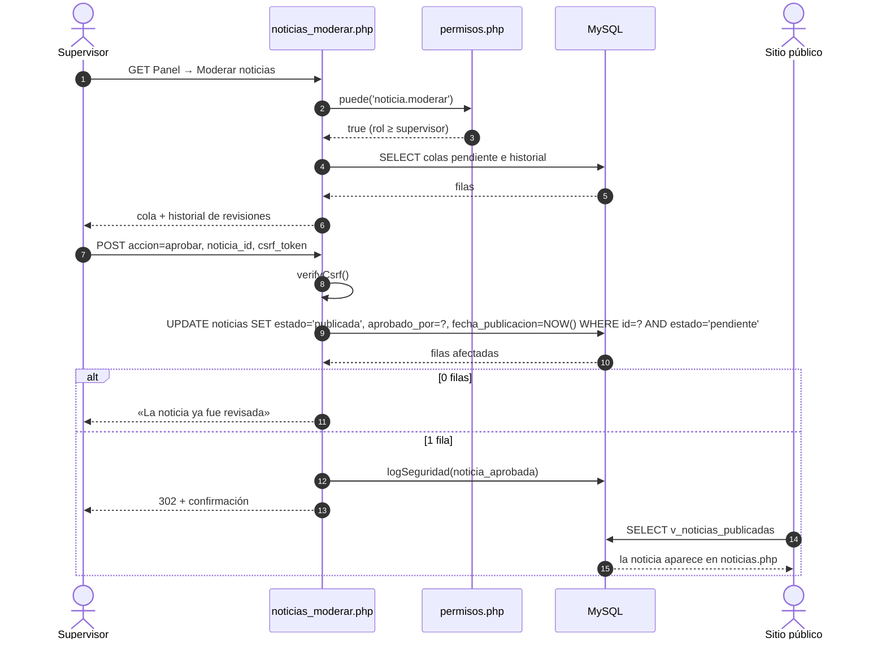

---

## 5. Diagrama de estados de una noticia

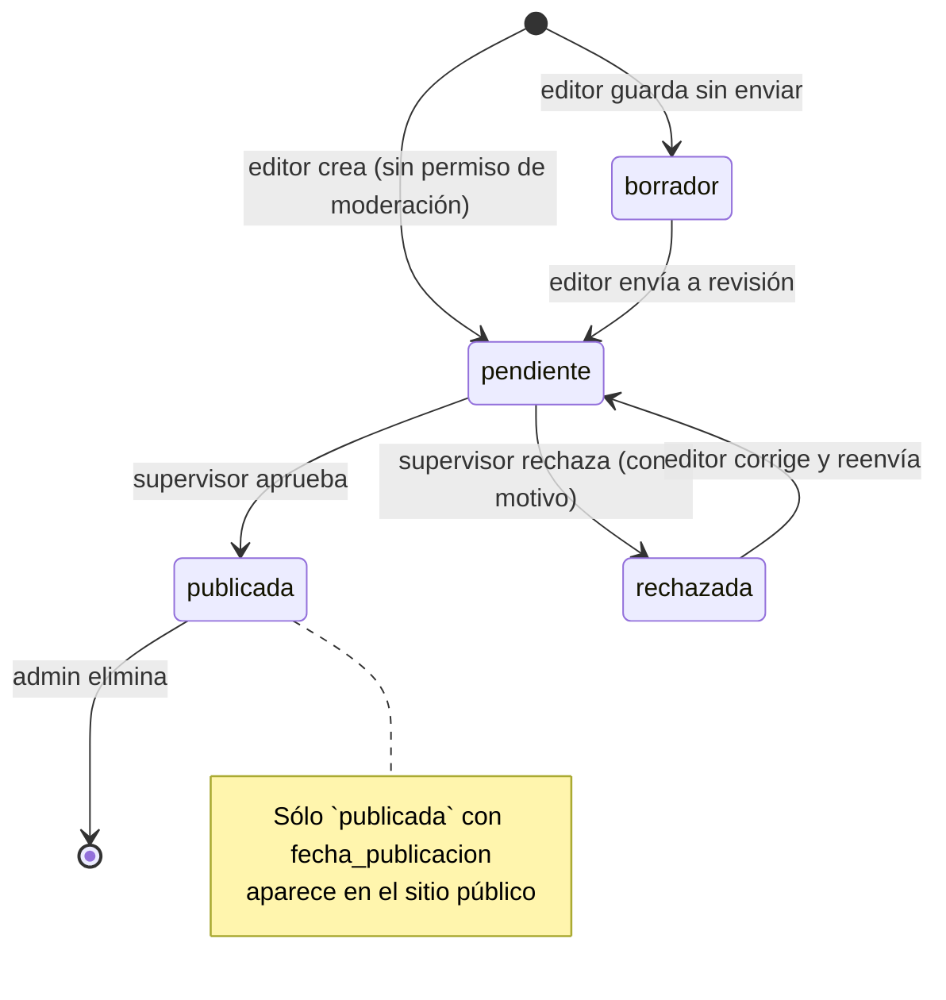

---

## 6. Cómo reproducir los diagramas

```bash
# Extensiones recomendadas de VS Code:
#   - Mermaid Preview  (markdown.mermaid / "Markdown Preview Mermaid Support")
# En línea:  https://mermaid.live
# En GitHub: los bloques ```mermaid se renderizan solos
```

Si agregás un diagrama nuevo, mantené este orden: **entidad-relación →
casos de uso → procesos → secuencia → estados**.
